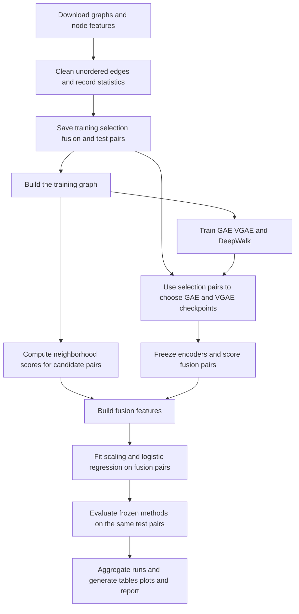

# Heuristic Fusion with Variational Graph Autoencoders for Link Prediction

This project tests whether five simple network similarity measures improve a Variational Graph Autoencoder (VGAE) when their scores are combined by logistic regression. It is scoped for three team members and a submission in ten days, assumed to be 19 October 2026. The required outcome is a reproducible experiment on three datasets, a complete coursework report, and an explanation the team can defend in a viva. Better prediction scores are a hypothesis to test.

## Project decision

| Item | Decision |
| --- | --- |
| Base paper | Kipf and Welling, Variational Graph Auto-Encoders, 2016 |
| Proposed title | Heuristic Fusion with Variational Graph Autoencoders for Link Prediction |
| Main datasets | Cora, CiteSeer, PubMed through PyG Planetoid |
| Optional extension | AttributedGraphDataset Facebook, after the required experiments finish |
| Proposed method | VGAE score plus CN, Jaccard, Adamic–Adar, Resource Allocation, Preferential Attachment; logistic regression fusion |
| Existing methods | VGAE, GAE, DeepWalk, and each heuristic individually |
| Primary metrics | ROC AUC and Average Precision (AP) |
| Repetitions | Five predetermined runs for the complete study; ten only if time permits |
| Contribution | Extension relative to VGAE plus controlled ablations and analysis by neighborhood overlap |
| Excluded from core scope | New GNN architectures, MLP fusion, large graph benchmarks, deployment, web dashboard |

Citation networks are information networks rather than interpersonal social networks. The graph methods and network structure analysis make this a reasonable SNA topic, but acceptance of citation benchmarks remains a course-specific assumption. If the course requires an interpersonal network, promote Facebook into the three required benchmarks and retain PubMed as the fourth dataset. Do not silently change the dataset roster after seeing results.

## What the supplied conversation gets right and what needs correction

The proposed components are understandable, datasets are public, and the coding work can share one evaluation pipeline. Heuristics and a learned graph representation provide different kinds of evidence, making the fusion question suitable for a small empirical study.

| Claim or design in the chat | Assessment and planning consequence |
| --- | --- |
| The base paper must be recent | The supplied rubric restricts the literature review to 2022 onwards; it gives no explicit date restriction for the base paper. Keep the classic base paper unless a later course instruction says otherwise. |
| The supplied bibliography meets the review requirement | It lists seven journal entries and several conference/workshop entries. That does not meet ten journals. Use the verified shortlist in docs/LITERATURE_SHORTLIST.md and complete the evidence matrix from full texts. |
| Fusion is novel | It is an extension of the selected base model. Structural features and learned embeddings have already been combined in the literature. Do not claim invention of heuristic fusion. |
| Fusion should improve results | Improvement is uncertain. A valid study can find a benefit on some datasets, no benefit, or degradation. |
| Six inputs make overfitting unlikely | A small model still overfits small samples and correlated signals. Use L2 regularization, an independent fusion set, and repeated runs. |
| Logistic coefficients reveal importance | Coefficients describe conditional associations after scaling. Correlated heuristics make their magnitudes unstable. Interpret them alongside ablations. |
| Select VGAE and fit fusion on the same validation pairs | This adapts two stages to one sample; it does not automatically leak the final test, but makes validation performance optimistic. Separate selection and fusion sets. |
| Ten runs reproduce the original experiment | The original reports random initializations on fixed dataset splits and standard error. Varying splits and reporting standard deviation is a different protocol. |
| Published scores are directly comparable | Shared dataset names and metrics are insufficient. Different graph preparation, splits, losses, and negative sampling prevent a controlled comparison. Keep published numbers separate. |
| All runs take minutes on CPU | Measure a pilot before estimating total time. PubMed, DeepWalk, and repeated training can cost more. |

The [VGAE paper](https://arxiv.org/pdf/1611.07308) establishes the original architecture and experimental settings. Closely related journal work includes [NCSM](https://doi.org/10.1016/j.neucom.2024.127820), which uses centrality and similarity features with a graph neural network, and [the iScience stacking analysis](https://doi.org/10.1016/j.isci.2022.105697), which challenges the assumption that combining predictors necessarily improves performance.

## Research questions and contribution

1. Does adding neighborhood heuristics improve VGAE AUC and AP under the same graph and test pairs?
2. Does the full fusion improve on a classifier using heuristics alone?
3. Are differences associated with the presence of common neighbors, endpoint degree, and graph sparsity?

Proposed contributions relative to the base paper are a separate, regularized fusion stage and diagnostic experiments that show when the added structural information helps. The method will remain deliberately simple. A claim about social-versus-citation network differences requires completing the optional social benchmark.

## Components explained

A graph contains nodes and edges. Here, nodes are papers and an edge indicates a citation relationship; the benchmark is treated as undirected. An adjacency matrix records these connections. Node features describe the words associated with each paper. The class labels and the node-classification masks supplied by Planetoid are unused.

Link prediction assigns a score to a pair of nodes. We remove real edges and test whether they receive larger scores than randomly sampled pairs with no observed edge. This is static missing-edge recovery: there are no timestamps establishing future relationships. All nodes and their features remain available, so the setting is transductive, meaning prediction concerns nodes already in the graph.

For a node u, let N(u) be its neighbors in the observed training graph and d(u) its degree. Let C(u,v) = N(u) intersect N(v). The five scores are:

| Score | Formula | Interpretation |
| --- | --- | --- |
| Common Neighbors (CN) | \|C(u,v)\| | More shared neighbors suggest a stronger relationship. |
| Jaccard (JC) | \|C(u,v)\| / \|N(u) union N(v)\| | Normalize overlap by neighborhood size. |
| Adamic–Adar (AA) | sum over w in C(u,v) of 1 / log d(w) | Shared neighbors with fewer connections contribute more. |
| Resource Allocation (RA) | sum over w in C(u,v) of 1 / d(w) | Penalize high-degree common neighbors more strongly. |
| Preferential Attachment (PA) | d(u) d(v) | Pairs of well-connected nodes receive larger scores. |

Use natural logarithms. Empty sums are zero; define Jaccard as zero when its denominator is zero. On a simple graph, a common neighbor of two distinct nodes has degree at least two, so AA is well-defined. CN, JC, AA, and RA are all zero without shared neighbors; PA can still distinguish such pairs.

An embedding is a short numerical description of a node. A Graph Convolutional Network (GCN) learns embeddings by mixing a node's features with its neighbors' features. Degree normalization prevents highly connected nodes from dominating merely because they have more neighbors. Self-loops let a node retain its own features; they are added internally to the encoder and excluded from prediction labels and heuristics.

The GCN update is H_next = activation(A_hat H W), with A_hat = D_tilde^(-1/2)(A_train + I)D_tilde^(-1/2). W contains learned parameters. The first layer uses ReLU; the output heads are linear. Two layers propagate information over at most two graph hops.

A Graph Autoencoder (GAE) learns one embedding z_u per node and reconstructs an edge score using z_u dot z_v. VGAE instead learns a mean mu_u and log standard deviation log sigma_u for a Gaussian embedding distribution. Training samples z_u = mu_u + sigma_u * epsilon, where epsilon is standard Gaussian noise. A KL divergence penalty regularizes these distributions toward a standard Gaussian. Evaluation uses the means to give deterministic scores. The shared encoder has a 32-dimensional hidden layer and 16-dimensional outputs.

Fusion uses the vector [mu_u dot mu_v, log1p(CN), JC, log1p(AA), log1p(RA), log1p(PA)]. Each column is standardized using statistics fitted only on fusion-training pairs. Logistic regression learns score sigmoid(w dot f + b), with L2 regularization. The sigmoid score ranks candidate links; fitting to balanced samples does not establish calibrated probabilities for the much sparser real-world population.

## Data and preparation

| Dataset | Nodes | Expected unique undirected edges | Feature dimensions |
| --- | ---: | ---: | ---: |
| Cora | 2,708 | 5,278 | 1,433 |
| CiteSeer | 3,327 | 4,552 | 3,703 |
| PubMed | 19,717 | 44,324 | 500 |

These are expected counts for the [PyG Planetoid version](https://pytorch-geometric.readthedocs.io/en/latest/generated/torch_geometric.datasets.Planetoid.html); its stored edges include both orientations. Export actual counts after removing loops, canonicalizing unordered pairs, and deduplicating. AttributedGraphDataset supplies different versions of the citation graphs, so do not mix its citation loaders with Planetoid.

For each dataset, record the download source, retrieval date, package version, raw-file hashes, node count, stored and unique edge counts, feature shape, graph density, mean degree, isolates, components, and clustering coefficient. Retain all nodes and components. Do not restrict the graph to its largest component to make results look stronger.

The optional [attributed Facebook loader](https://pytorch-geometric.readthedocs.io/en/latest/generated/torch_geometric.datasets.AttributedGraphDataset.html) lists 4,039 nodes, 88,234 edges, and 1,283 features. Check its actual representation and provenance independently; Facebook page graphs used in other papers are different datasets.

## Experimental protocol

### Four sets with separate purposes

Partition canonical positive edges once per run, rounding selection/fusion/test counts down and assigning the remainder to training.

| Set | Fraction of original edges | Permitted use |
| --- | ---: | --- |
| Observed training edges | 80% | Encoder graph, encoder reconstruction labels, DeepWalk walks, all heuristic neighborhoods |
| Selection positives | 5% | Choose encoder checkpoint by AP; no fusion fitting |
| Fusion positives | 5% | Fit the scaler and logistic regression; no encoder training or checkpoint selection |
| Test positives | 10% | Final frozen evaluation and predetermined diagnostics |

Selection, fusion, and test sets each receive one uniformly sampled non-edge per positive edge. Sample from the complement of the entire original benchmark graph, without self-pairs, duplicate unordered pairs, or overlap between these negative sets. This use of the original edge registry is a benchmark labeling/exclusion operation, not an input graph for learning.

Training negatives also exclude every original positive edge and the reserved evaluation/fusion negative pairs. Resample them each epoch at a 1:1 ratio with training positives. Never use held-out positive edges as training negatives.

Compute every embedding and heuristic against the same 80% graph throughout the run. PyG's [RandomLinkSplit source](https://pytorch-geometric.readthedocs.io/en/latest/_modules/torch_geometric/transforms/random_link_split.html) constructs its test message-passing graph from training plus validation edges. For this project, implement the four-set split explicitly or override all evaluation graph inputs with the saved training graph. Never blindly use test_data.edge_index.

The original paper uses 85/5/10. Our additional fusion set changes that protocol. Report it clearly; do not describe the main experiment as exact reproduction. An optional separate 85/5/10 VGAE sanity run can help investigate a reproduction discrepancy, but is not mixed into the fusion comparison.

### Model settings

| Parameter | Initial fixed setting |
| --- | --- |
| Encoder | GCN shared hidden width 32, embedding width 16 |
| Optimizer | Adam, learning rate 0.01, weight decay 0 |
| Training | Up to 200 epochs, selection AP every 10 epochs; retain best checkpoint, earlier wins ties |
| Dropout | 0 |
| Node features | Row-normalized features; leave zero rows zero |
| GAE reconstruction loss | Mean positive BCE plus mean negative BCE |
| VGAE loss | Same reconstruction loss plus beta times mean per-node KL; beta = 1 / node_count |
| Fusion | StandardScaler then LogisticRegression, C = 1, L2, max_iter = 1000, lbfgs |
| Randomness | Run IDs 0–4; derive and save separate split, initialization, walk, and negative-sampling seeds |
| Test | All methods use the identical saved test labels and pairs |

Write the exact KL reduction in the implementation and report: K_mean = -(1/(2N)) sum over nodes and latent dimensions of [1 + 2 log sigma - mu^2 - exp(2 log sigma)]. With beta = 1/N, the added term is K_mean/N. This is an explicit PyG-style training choice, not an assertion that it numerically reproduces the original full-adjacency objective. PyG's [autoencoder implementation](https://pytorch-geometric.readthedocs.io/en/latest/_modules/torch_geometric/nn/models/autoencoder.html) averages KL over nodes and expects log standard deviation. Avoid accidentally treating log variance as log standard deviation.

Use the same normalization and reconstruction convention for GAE and VGAE. Document negative sampling as a difference from the base paper's reweighted full-adjacency experiment. No broad hyperparameter search is required. Any pilot-driven setting change must be made using selection data before final test evaluation, logged, and applied to all final runs.

For DeepWalk, use unbiased walks on the same training graph, 128-dimensional embeddings, 10 walks per node, walk length 80, context window 10, and one training epoch. Stream the walks rather than holding all tokens in memory. Use one worker for repeatable training and record the Skip-gram implementation and objective. Score pairs by embedding dot product. These starting settings follow the VGAE comparison; a modern Skip-gram implementation remains a reimplementation. The separate [DeepWalk paper](https://arxiv.org/abs/1403.6652) provides a second distinct existing work for the rubric.

Keep the core run count at five complete runs per dataset. Ten are an extension. Use paired comparisons: for each run subtract the baseline's metric from fusion's metric. Report mean, sample standard deviation, and individual differences. These runs assess split/initialization sensitivity; they are not five independent real-world networks.

## Pipeline and required comparisons



Run the following without retraining VGAE for each fusion ablation:

| Model or diagnostic | Purpose |
| --- | --- |
| CN, JC, AA, RA, PA individually | Classical SNA baselines |
| DeepWalk | Independent published representation method |
| GAE and VGAE | Assess the base architecture and its variational component |
| Heuristics-only logistic regression | Test whether embeddings add anything beyond counting |
| VGAE-score-only logistic regression | Control for effects of fitting a classifier to the raw score |
| VGAE plus all five heuristics | Proposed method |
| Full fusion minus each heuristic | Estimate each feature's incremental contribution |
| CN = 0 and CN > 0 test subsets | Diagnose where local overlap matters |

For the subgroup analysis, report positive and negative counts and prevalence. If either class is missing, AUC is undefined; report NA. AP comparisons across subgroups need their differing positive prevalence stated. Do not choose new subgroup thresholds after looking at scores.

## Evaluation and interpretation

ROC AUC measures how often a positive edge outranks a negative pair, allowing half credit for ties. AP summarizes precision at increasing recall. Use scikit-learn roc_auc_score and average_precision_score; AP is not the same calculation as trapezoidal PR area. Both metrics are threshold-free. Report values consistently as either fractions or percentages.

The primary test candidate sets are balanced; their scores do not represent ranking among all possible non-edges. An optional frozen-model test with ten negatives per positive can examine negative-sampling sensitivity. If included, run every comparison method on the identical expanded pairs and label the changed ratio clearly. Hits@K and hard-negative mining are outside the core schedule.

Record download/preparation, encoder training, walk training, feature extraction, fusion fitting, and scoring runtimes separately. Save the machine specifications and device. Claims of low computational cost require measured time.

Published numbers may appear in a separate contextual table with their source, protocol, and uncertainty definition. The main comparison table contains our reruns. GAE and VGAE are two methods from one publication, so DeepWalk protects the stricter interpretation of two existing works. If the professor instead requires two recent journal methods implemented, that is a scope change requiring a different baseline roster.

Interpret a fusion improvement against both VGAE and heuristics-only fusion. If fusion improves on VGAE but loses to heuristics-only, embeddings have not demonstrated additional value. If the benefit is inconsistent, report that rather than presenting only the best dataset or seed.

## Coding agent work sequence

| Stage | Work | Required artifact and completion gate |
| --- | --- | --- |
| 1 | Set up a project-local environment; verify torch/PyG on a tiny graph | Dependency lock or exact versions, environment.json, successful one-epoch smoke run |
| 2 | Load all three datasets, canonicalize edges, save four-way splits | Dataset statistics, file hashes, split manifests, and invariants passing |
| 3 | Implement pairwise neighborhood scores using adjacency sets | Tiny hand-calculated graph checks including isolates, no-common-neighbor cases, and symmetry |
| 4 | Implement GAE and VGAE with explicit graph inputs, loss reductions, and checkpoints | One Cora run with finite losses, saved checkpoint, selection scores, and timings |
| 5 | Implement fusion and its controls | Features saved with pair IDs; scaler fitted only on fusion pairs; reproducible scores |
| 6 | Implement DeepWalk and validate memory/runtime | Same graph hash as encoders; every node has an embedding; smoke test on Cora and PubMed |
| 7 | Freeze config, then execute five runs on every required dataset | Complete per-run metrics and predictions, failures visible, resume skips completed runs |
| 8 | Aggregate results, ablations, coefficients, and neighborhood diagnostics | Tables and figures regenerated from saved predictions; no hand-entered result values |
| 9 | Merge report evidence with literature, limitations, and references | Every course requirement mapped to an output; all results traceable to artifacts |

Use a small Python package with modules for data, splits, heuristics, encoders, DeepWalk, fusion, metrics, and report exports. Plan one entry point that accepts dataset, run ID, config, and resume. Use NumPy, SciPy, pandas, scikit-learn, NetworkX for reference checks, Matplotlib, PyTorch/PyG, and a Skip-gram implementation such as gensim. Resolve compatibility during the pilot and pin the working versions.

Suggested output organization:

```text
configs/main.yaml
src/sna_project/
tests/
data/raw/
data/processed/
artifacts/<dataset>/<run_id>/
    split_manifest.json
    checkpoints/
    pair_features.parquet
    predictions.parquet
    metrics.json
    timings.json
results/tables/
results/figures/
docs/literature_matrix.xlsx
report/
```

The folders above describe future implementation; this planning task does not create or claim completed experiments. Cache per-pair scores and embeddings. Score candidate pairs only: a dense PubMed N by N float32 score matrix alone would contain about 389 million values, roughly 1.56 GB before additional training memory.

Required invariants cover disjoint positive partitions including reversed edges; true non-edge negative labels; no self-pairs; no evaluation edge in the training adjacency; identical graph hashes across methods; and test labels inaccessible to fitting and selection functions. Evaluate heuristic formulas against hand calculations. Include a graph-input check showing that modifying held-out adjacency fields cannot change scores. These checks address scientific validity rather than merely mirroring code.

## Team and ten day schedule

Assume today is 9 October and submission is 19 October; use 10–19 October as the ten-day work window. Team members can exchange responsibilities, but each output has one owner.

| Person | Primary responsibility | Review responsibility |
| --- | --- | --- |
| A | Data/splits, GAE/VGAE, shared experiment runner | Verify methodological statements in the report |
| B | Ten journal reviews, references, introduction and related work | Check dataset identities and comparison protocols |
| C | Heuristics, fusion, DeepWalk, plots and report assembly | Audit splits and metrics independently |

| Date | Implementation and experiments | Literature and report |
| --- | --- | --- |
| 10 Oct | Environment, dataset audit, four-way splits | Confirm course wording; retrieve ten papers and record metadata |
| 11 Oct | Heuristic checks and Cora encoder pilot | Read base paper; draft introduction and review matrix |
| 12 Oct | Cora fusion and DeepWalk; measure PubMed pilot | Draft methodology, diagram, and experimental setup |
| 13 Oct | Finalize settings and validity checks; freeze protocol | Finish ten paper descriptions, verify citations |
| 14 Oct | Run required three-dataset batch with resume | Draft dataset and metric sections |
| 15 Oct | Finish five runs per dataset; resolve failed runs | Assemble tables and initial analysis |
| 16 Oct | Run cheap ablations and subgroup analysis | Explain gains, null results, and limitations |
| 17 Oct | Optional Facebook or additional runs only if core complete | Finish report, proposed abstract, and presentation |
| 18 Oct | Rebuild outputs from saved artifacts; independent audit | Check rubric coverage, figure captions, references; rehearse viva |
| 19 Oct | Buffer and submission | Final proofreading and package handoff |

If behind schedule, remove Facebook, extra seeds, and optional sampling tests first. Preserve all three required datasets, five complete runs, existing-method comparisons, protocol checks, and the ten-journal review. Avoid starting new architectures in the final days.

## Report requirements and outputs

The pasted template contains more requirements than its reference to fifteen points suggests. Use every listed requirement as the checklist.

| Requirement | Evidence or output |
| --- | --- |
| Team number, names, registrations | Fill with verified team details; retain placeholders until supplied |
| Base and proposed titles | Project decision table |
| Proposed abstract of 150 words | Motivation, approach, datasets, metrics, intended contributions; no invented results |
| Introduction of 1–2 pages | Missing-edge recovery, SNA motivation, heuristics and embeddings |
| Base paper contributions, 3–4 items | Variational node representations, graph encoder, inner-product decoder, feature-enabled benchmark evaluation |
| Our contributions, 1–2 items | Fusion relative to VGAE and controlled neighborhood/ablation analysis |
| Ten recent journal reviews | Methodology, exact datasets, metrics, advantages, limitations, and supporting section/table for every entry |
| Overall flow and diagram | Two methodology paragraphs and pipeline figure |
| Concepts, equations, reasons for choices | Heuristics, GCN, VGAE, explicit loss, fusion, four-set protocol |
| Difference from existing work | Simpler external fusion and diagnostic study; acknowledge related fusion methods |
| Environment, tools and model parameters | Saved versions, device and hardware; fixed config |
| At least three benchmark URLs and statistics | Dataset provenance and audited statistics |
| At least two evaluation metrics | AUC and AP definitions |
| Results with tables and graphs | Main metric table, paired differences, ablations, subgroup counts, runtime plots, representative ROC/PR curves |
| Two existing works on identical datasets | Our VGAE and DeepWalk reruns, supplemented by GAE and heuristics |
| Conclusion, limitations and future work | Findings actually demonstrated; random deletion, sampled negatives, small graphs, transductive setting, limited novelty |
| Important references | Verified bibliography; distinguish journal, conference, workshop and preprint |

All five runs feed the main table. Choose run 0 in advance for illustrative ROC/PR plots; do not select the prettiest run. Coefficient plots must identify the standardized feature definition and show variability across runs. Report original-paper standard error separately from our standard deviation.

## Completion criteria

The project is complete when all three datasets have full results under the frozen protocol, the proposed method and required baselines share test pairs, the validity checks pass, ten journal entries have complete evidence-based reviews, and tables/figures can be regenerated from saved outputs. Every team member should be able to explain the graph, five heuristics, VGAE, fusion fitting, split design, AUC/AP, and actual conclusion without relying on the coding agent.

No gain is guaranteed and no empirical results are available at planning time. If fusion fails to improve, retain the experiment and conclude that these simple late-fusion features did not consistently add value under this protocol. That finding is preferable to changing the test or omitting failed runs.
