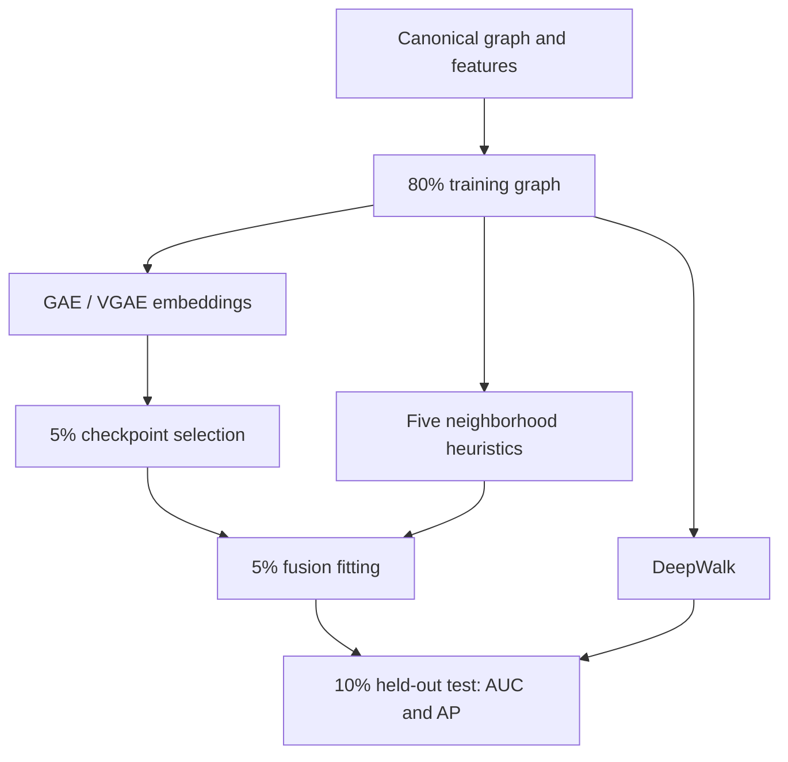
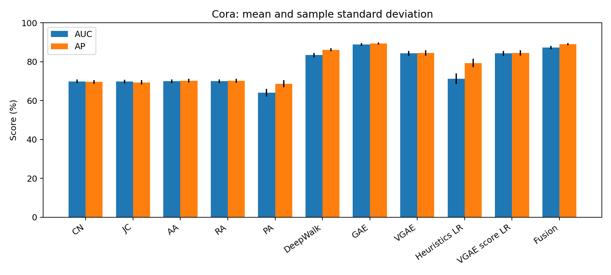
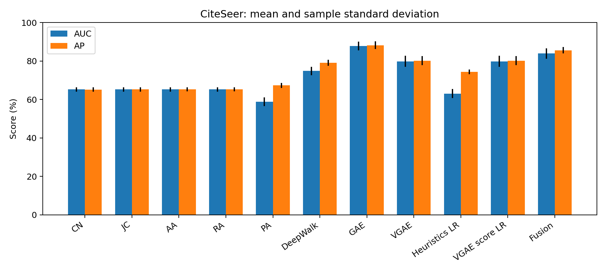
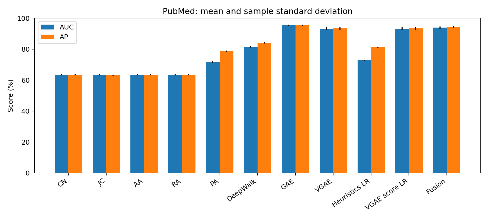
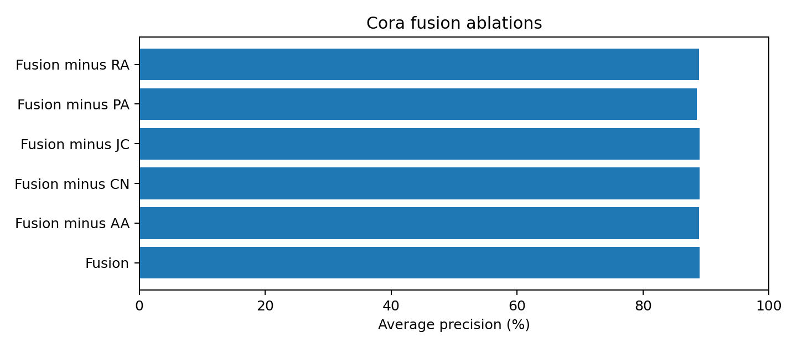
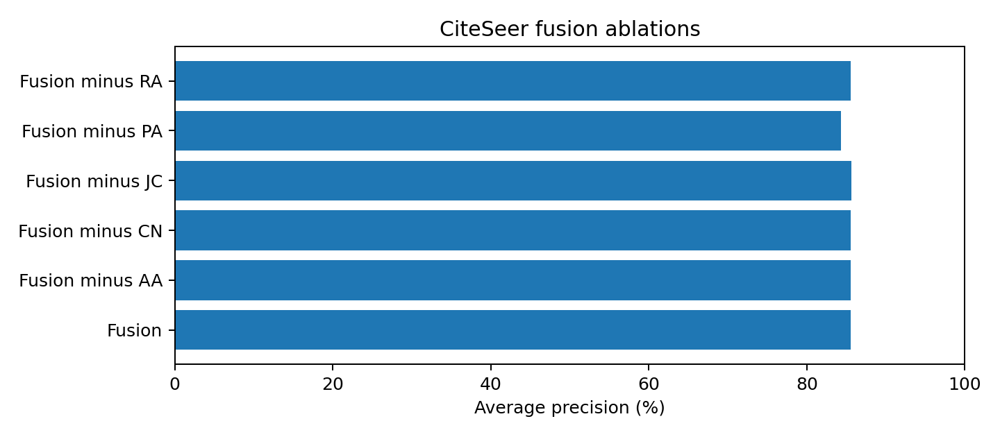
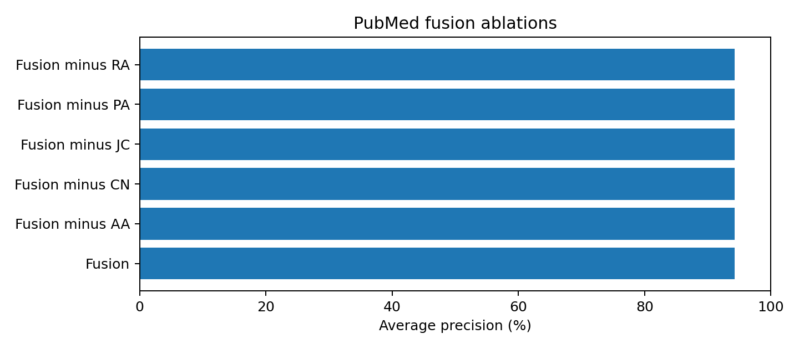
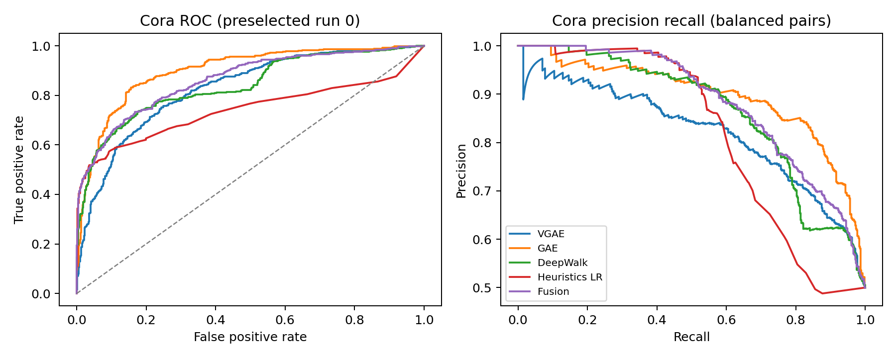
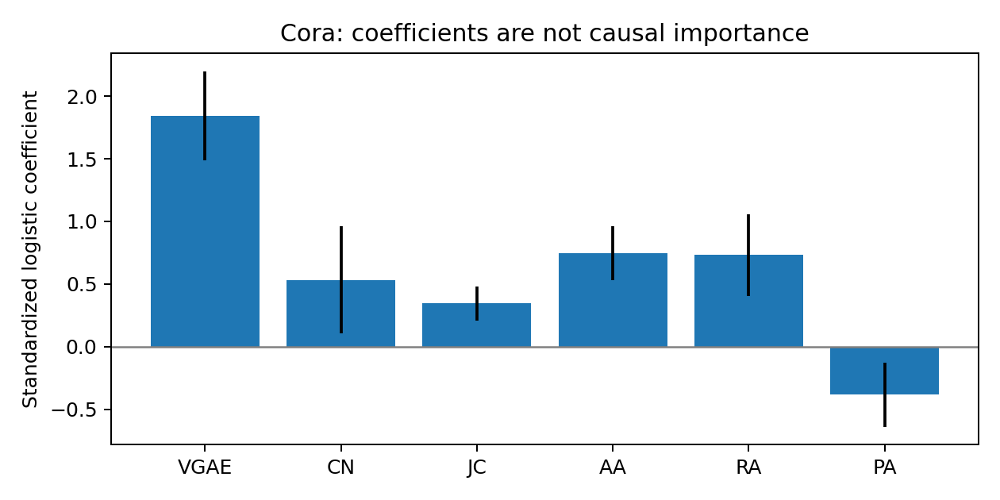
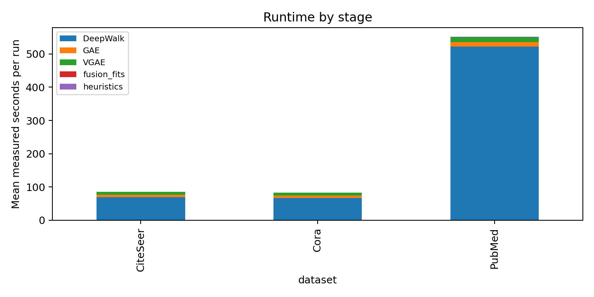

# Fusing Neighborhood Heuristics with Variational Graph Autoencoders for Link Prediction

SOCIAL NETWORK ANALYSIS · COURSEWORK PROJECT

A reproducible study on Cora, CiteSeer and PubMed

Three benchmarks · Five runs per benchmark · Held-out-pair demo

| Team no. | Member name | Registration number |
| --- | --- | --- |
|  |  |  |
|  |  |  |
|  |  |  |

Base paper: Thomas N. Kipf and Max Welling, “Variational Graph Auto-Encoders,” 2016 [1].

Team identity fields are intentionally blank and can be filled in docs/team.json before regenerating this report.

Experiment status: all 15 runs completed and audited. Source and data fingerprints, saved predictions, split invariants and fusion preprocessing are retained in the reproducibility package.

Prepared: 09 October 2026. This report contains measured local experiments; literature results are identified separately.

## 1. Abstract

Link prediction estimates missing relationships from observed network structure. This project tests whether interpretable neighborhood information improves a Variational Graph Autoencoder on three citation benchmarks: Cora, CiteSeer and PubMed. We combine its embedding dot product with Common Neighbors, Jaccard, Adamic-Adar, Resource Allocation and Preferential Attachment using logistic regression. A fixed, explicitly documented four-part edge protocol separates graph training, checkpoint selection, fusion fitting and final testing. Every method uses the same training graph and balanced test candidates. Independent implementations of DeepWalk, deterministic graph autoencoders and standalone heuristics provide controlled comparisons. Five runs per dataset measure ROC AUC and average precision, while feature-removal ablations and common-neighbor subgroups examine where fusion helps. Saved splits, predictions, model checkpoints and environment records support reproducibility. The local demo exposes both results and individual score calculations. Findings are limited to static, transductive missing-edge recovery; they establish neither future-link forecasting nor calibrated probabilities across all possible node pairs.

Keywords: link prediction; social network analysis; variational graph autoencoder; neighborhood heuristics; reproducibility.

### 2. Introduction

Networks represent entities as nodes and relationships as edges. A social friendship network connects people, a collaboration network connects authors, and a citation network connects papers through references. Although their meanings differ, all exhibit structural patterns such as shared neighborhoods, unequal degree distributions and clusters of related entities. Social network analysis studies these patterns to understand how relationships are organized. Link prediction turns that structural information into a measurable task: given a partially observed network, rank pairs that may have a missing relationship. This can support recommendation, data completion and the prioritization of further observation. The present study uses citation networks as accessible attributed benchmarks; it does not equate citations with friendships.

Simple neighborhood methods provide a useful starting point. Common Neighbors counts shared adjacent nodes, Jaccard adjusts overlap for neighborhood size, Adamic-Adar and Resource Allocation discount high-degree intermediaries, and Preferential Attachment uses endpoint degrees. These features connect prediction to recognizable network mechanisms, including triadic closure and hub connectivity. Their limitation is equally concrete: when two endpoints share no observed neighbor, four of the five measures produce identical zero scores. Missing edges, disconnected components and sparse observations can therefore hide the very evidence on which these methods rely. Degree-based scores remain available, but popularity alone may create many false positives.

Representation learning supplies another view. DeepWalk uses random walks and a Skip-gram objective to embed nodes whose structural contexts are similar [2]. A graph autoencoder uses graph convolutions and node attributes to learn representations that reconstruct observed adjacency. VGAE adds a Gaussian latent-variable model to that framework [1]. Its inner-product decoder is compact and easy to implement, yet the dot product does not explicitly expose pairwise neighborhood overlap. The question addressed here is whether a small supervised fusion model can recover useful local information that the VGAE score leaves unresolved. A deterministic GAE comparator also tests whether the variational model is the strongest simple encoder under the chosen training budget.

Combining structural predictors with embeddings is established research. The journal review includes attribute-preserving autoencoders, topology-aware attention, motif representations and stacking methods [3]-[12]. Our contribution is therefore an extension relative to the selected VGAE base paper and a controlled experimental study, rather than a claim to invent hybrid link prediction. The fusion classifier uses six input values and a separate fitting partition. This keeps its calculation inspectable and permits matched controls: a model using only the five heuristics and another using only the VGAE score. Leave-one-heuristic-out variants examine incremental effects without requiring a new encoder architecture.

Credible comparison requires clear information boundaries. Randomly hiding an edge is insufficient if a later transformation places it back into the encoder graph or if a scaler is fitted using test examples. We explicitly fix the training graph for every method, reserve separate edges for checkpoint selection and fusion fitting, and evaluate on the same test pairs. Negative pairs are sampled from the complement of the original graph, preventing a hidden true edge from being mislabeled during training. All nodes and attributes remain visible, so this is transductive recovery of randomly missing undirected edges. It is not a chronological forecast and does not address unseen-node generalization.

The project evaluates three benchmarks and five paired runs per benchmark using ROC AUC and average precision. The run variation includes both edge splits and random initialization. Tables report means and sample standard deviations; subgroup analysis retains counts and prevalence so that changes in candidate difficulty remain visible. The demo lets a viewer inspect a held-out pair, its visible neighborhood and the numerical fusion decomposition. The report presents results whether or not fusion wins, because a reliable answer about the contribution of local structure is more useful than a favorable score produced by inconsistent evaluation.

## 3. Base paper and project contribution

### 3.1 Major contributions of the base paper

1. A graph latent-variable model with a factorized Gaussian approximate posterior, parameterized by graph convolutions.

2. An inner-product Bernoulli decoder that relates latent node representations to adjacency reconstruction.

3. Variational training with a reconstruction term and a prior-matching KL term, alongside a deterministic GAE alternative.

4. Link-prediction experiments on attributed citation graphs and comparisons with structural representation baselines.

These describe the base architecture. Our sampled loss, graph partition and checkpoint policy are deliberately documented deviations, so the experiment is a controlled reimplementation rather than an exact numerical reproduction of the original table.

### 3.2 Contributions relative to the base paper

1. A post-encoder fusion model combines the VGAE score and five structural heuristics. The encoder is unchanged and the fusion model is fitted on a distinct hidden-edge partition.

2. A reproducible comparison includes matched GAE/DeepWalk baselines, single-source fusion controls, five feature-removal ablations, zero-common-neighbor analysis, prediction-level audits and an interactive demonstration.

Scope of novelty: this is a coursework extension of VGAE. Related journal methods already combine graph representations with structural information. A positive result supports the tested mechanism on these graphs; it does not establish state-of-the-art performance or universal benefit.

## 4. Literature review: ten recent journal papers

The assignment specifies 2022 onwards. The following ten entries are journal publications within that range, and each description is based on accessible full text. Surveys and conference preprints from the preliminary shortlist are not counted. The notes distinguish reported advantages from protocol limitations identified in this review.

### [3] Modularity-aware graph autoencoders for joint community detection and link prediction

Guillaume Salha-Galvan, Johannes F. Lutzeyer, George Dasoulas, Romain Hennequin, Michalis Vazirgiannis. Neural Networks, 2022. DOI: 10.1016/j.neunet.2022.06.021.

Methodology: Modularity-informed message passing and a community-preserving regularizer extend deterministic and variational graph autoencoders. Louvain supplies a prior partition; both linear and GCN encoders are studied.

Datasets: Cora, CiteSeer and PubMed, with and without attributes; Cora-Large; political Blogs; a 100,000-node stochastic block model; and the industrial Deezer-Album graph.

Performance metrics: AUC and AP for missing-edge recovery; adjusted mutual information and adjusted Rand index for communities.

Advantages: Joint-task experiments and encoder/loss ablations show that explicitly preserving communities can improve embeddings without abandoning link prediction.

Limitations and relevance: The authors report sensitivity to hyperparameters and smaller community gains on attributed citation graphs. A Louvain prior may carry its own resolution bias. This modifies training, whereas our fusion operates after encoding.

Evidence: Sections 3, 4.1 and 4.2; Tables 3 and 6-8; limitation discussion. Author manuscript archived locally.

### [4] Fair Benchmark for Unsupervised Node Representation Learning

Zhihao Guo, Shengyuan Chen, Xiao Huang, Zhiqiang Qian, Chunsing Yu, Yan Xu, Fang Ding. Algorithms, 2022. DOI: 10.3390/a15100379.

Methodology: FURL benchmarks thirteen unsupervised representation learners under fixed-time random hyperparameter search. It separates validation-tuned classification, first-run-tuned link prediction, and classification tuned through link prediction.

Datasets: Cora, CiteSeer, PubMed, Flickr, BlogCatalog, Chameleon, Film and Squirrel.

Performance metrics: ROC AUC and AP for link prediction; micro and macro F1 for classification. Link prediction uses balanced sampled pairs, embedding dot products and ten evaluation runs after tuning.

Advantages: Equal tuning budgets and multiple downstream tasks expose how evaluation choices alter model rankings.

Limitations and relevance: Fixed time is hardware dependent, and an overall rank aggregates different tasks. Published CiteSeer/PubMed edge counts differ from our canonical PyG graphs. We use a fixed configuration and distinct checkpoint/fusion partitions instead of reproducing its search budget.

Evidence: Sections 2.2, 3.2 and 4; Tables 2 and link-prediction results. Published PDF archived; DOI verified.

### [5] Graph Autoencoder with Preserving Node Attribute Similarity

Mugang Lin, Kunhui Wen, Xuanying Zhu, Huihuang Zhao, Xianfang Sun. Entropy, 2023. DOI: 10.3390/e25040567.

Methodology: GAEPNAS augments the graph with an attribute-similarity K-nearest-neighbor graph and reconstructs both adjacency and attribute similarity. Binary attributes use Jaccard similarity; PubMed TF-IDF attributes use cosine similarity.

Datasets: Cora, CiteSeer and PubMed citation networks.

Performance metrics: ROC AUC and AP for link prediction, plus clustering measures in a separate experiment. The link protocol is 85/5/10 with balanced validation/test negatives and ten runs.

Advantages: Preserving attribute relationships through the encoder and decoder provides information beyond observed adjacency. The paper includes parameter analysis.

Limitations and relevance: The authors' results are not uniformly best: GASN slightly exceeds it on PubMed. Dataset-specific K, mixing weights and training schedules complicate replication; PubMed uses 500 epochs. Our 80/5/5/10 protocol and sampled loss differ, so its table is context rather than a controlled comparator.

Evidence: Sections 3, 4.1 and 4.3; Tables 2-3. Full XML from Europe PMC archived.

### [6] Dynamic network link prediction with node representation learning from graph convolutional networks

Peng Mei, Yu hong Zhao. Scientific Reports, 2024. DOI: 10.1038/s41598-023-50977-6.

Methodology: GCN_MA enriches structural information with node aggregation, degree and clustering, then combines GCN representations with LSTM-based evolution of weights and multi-head attention to capture global and local changes.

Datasets: CollegeMsg, MOOC actions, Bitcoin OTC, Email-Eu-core-temporal, LastFM and Wikipedia interaction datasets.

Performance metrics: The paper labels its measures AUC and AP and reports component ablations. Its AP discussion gives a top-L precision equation, which differs from our threshold-integrated average precision.

Advantages: Combining structural features with temporal modeling addresses information omitted by a single static neighborhood.

Limitations and relevance: The authors limit the study to homogeneous discrete dynamic networks. Temporal snapshots and the metric-definition ambiguity prevent direct comparison with our static benchmark. This is relevant as a future extension, not an implemented baseline.

Evidence: Definitions and methods; Results and analysis; Tables 1-4 and Evaluation index subsection.

### [7] Incorporating high-frequency information into edge convolution for link prediction in complex networks

Zhiwei Zhang, Haifeng Xu, Guangliang Zhu. Scientific Reports, 2024. DOI: 10.1038/s41598-024-56144-9.

Methodology: EdgeConvHiF learns edge representations by combining high- and low-frequency node information with edge convolution and representation normalization.

Datasets: Cora, CiteSeer and PubMed. The paper states largest-connected-component processing but lists full-size node counts; its edge counts differ from our PyG canonical graphs.

Performance metrics: AUC and AUPR over ten runs under a 70/20/10 split; 256 hidden/output channels and 5,000 epochs.

Advantages: Edge-focused representations preserve differences between nodes that neighborhood smoothing can remove; normalization aims to stabilize learning.

Limitations and relevance: Table 3 does not show uniform superiority: PubMed GCN AUC exceeds EdgeConvHiF. Baseline numbers are reused from an earlier paper. The text's standard-error label and displayed dispersion formula differ, and its recall formula is mistyped. These reporting issues make numerical cross-paper comparisons especially fragile.

Evidence: Experiments and discussion; Tables 2-4; equations 19-20 and Evaluation indicator.

### [8] Sequential stacking link prediction algorithms for temporal networks

Xie He, Amir Ghasemian, Eun Lee, Aaron Clauset, Peter J. Mucha. Nature Communications, 2024. DOI: 10.1038/s41467-024-45598-0.

Methodology: Sequential stacking feeds 41 static structural predictors from consecutive snapshots into a supervised ensemble, including a random-forest stacking model. It distinguishes partially observed from completely unobserved target layers.

Datasets: Nineteen real temporal networks across domains, plus temporal stochastic block models with community and edge persistence controls.

Performance metrics: AUC is the main comparison measure; precision-recall evidence is also reported in supplementary analysis. The partially observed setting uses repeated cross-validation.

Advantages: Historical structural predictors provide an understandable alternative to expensive engineered temporal features, and ensemble variants combine complementary methods.

Limitations and relevance: Temporal history is essential and forty-one features can be costly. Synthetic near-oracle behavior does not establish universal performance on social systems. Our six-feature static logistic fusion tests a smaller related mechanism without claiming temporal forecasting.

Evidence: Results; Sampling dyads and supervised-learning Methods; Figure 1 and real-network comparisons.

### [9] Inductive Subgraph Embedding for Link Prediction

Jin Si, Chenxuan Xie, Jiajun Zhou, Shanqing Yu, Lina Chen, Qi Xuan, Chunyu Miao. Mobile Networks and Applications, 2025 issue; online 2024. DOI: 10.1007/s11036-024-02339-3.

Methodology: SE4LP samples local enclosing subgraphs, embeds them with a three-layer GIN, and jointly learns a link classifier and contrastive representations using augmented subgraphs.

Datasets: Cora, CiteSeer, PubMed, Facebook page-page mutual likes and GitHub. The Facebook identity differs from an ego-Facebook friendship network.

Performance metrics: AUC and AP. The full text describes sampled candidate pairs and dataset-dependent sampling percentages, with 8:1:1 labeled splits.

Advantages: A pair-centered subgraph captures local structural information that a node dot-product decoder may miss; contrastive supervision supplies another learning signal.

Limitations and relevance: Subgraph extraction and augmented examples add memory and computation. The evaluation and graph exposure differ between its own approach and some baselines, so reported superiority cannot be imported into our protocol. Our model is transductive and simpler; it does not demonstrate SE4LP's inductive capability.

Evidence: Methodology and Experiments; dataset/sampling descriptions; Tables 2-3. Full publisher HTML archived.

### [10] MCoGCN-motif high-order feature-guided embedding learning framework for social link prediction

Nan Xiang, Wenjing Yang, Xindi Rao. Scientific Reports, 2024. DOI: 10.1038/s41598-024-80509-9.

Methodology: MCoGCN propagates low- and high-order motif embeddings, fuses them through a compact attention mechanism, and alternates optimization with embedding refresh.

Datasets: Twitch-DE, Facebook, GitHub and Pokec. Seven motifs are used on the first three graphs; one is used on larger Pokec to control cost.

Performance metrics: Recall@20, NDCG@20, AUC and MRR; the paper averages five experiments and includes seed robustness and module ablations.

Advantages: Motifs describe relationships richer than pairwise adjacency. Scale-aware motif selection makes a large social-graph experiment feasible.

Limitations and relevance: The authors explicitly trade structural richness for cost on Pokec. Their weak-link study samples 100 negative links and compares average scores; this is not the same as subgroup AUC/AP on all our test candidates. GAT exceeds it on Twitch in a reported comparison, so gains are dataset dependent.

Evidence: Experiment: Metrics and Motif extraction; Overall performance, Weak link and Ablation study subsections.

### [11] TAGNN: topology-aware graph neural network framework for link prediction

Minsi Liang, Honggang Zhang. Scientific Reports, 2026. DOI: 10.1038/s41598-026-48184-0.

Methodology: TAGNN combines local pair-subgraph representations and topology-aware attention. Learned encodings of common neighbors, Jaccard, Adamic-Adar, shortest-path distance and path counts modify structural attention.

Datasets: Cora, CiteSeer, PubMed, ogbl-ppa, ogbl-citation2 and ogbl-vessel.

Performance metrics: AUC on citation/vessel tasks, Hits@100 on ogbl-ppa and MRR on ogbl-citation2. The text describes official OGB or classic splits, which must be distinguished by dataset.

Advantages: Pair topology supplements node-centered features; its attribute-removal experiment investigates whether neighbor attributes can be distracting.

Limitations and relevance: Subgraph and path computation add complexity. Different candidate sets, graph counts and metrics prevent direct ranking against our small sampled-pair experiment. Our fixed post-encoder logistic fusion is less expressive and easier to audit; it is not an implementation of TAGNN.

Evidence: Structural Encoding Fusion; Experiments datasets/baselines/results and neighborhood-feature ablation.

### [12] Link Prediction Using Node Influence Based on Graph Neural Networks

Madhusudhana Rao Baswani, Khyathisree Yarra, Prasanthi Boyapati, Eswaraiah Rayachoti, T. Jaya Lakshmi. IEEE Access, 2026. DOI: 10.1109/access.2026.3677526.

Methodology: LP-GNN combines centrality and classical similarity information with learned graph representations. Its displayed LP-GAE decoder adds a parameterized structural prior to an embedding dot product.

Datasets: The main results cover celegans-dir, netscience, euroroad, dolphins, infect-dublin, web-edu and enron-only; the dataset section says ten networks while the displayed comparison covers seven.

Performance metrics: AUROC and AUPR with 80% observed links and 20% held out in the experiment description.

Advantages: The mathematical structural prior makes the combination of influence and similarity inspectable and directly relevant to our fusion idea.

Limitations and relevance: The text and algorithm differ in split detail, and the displayed algorithm normalizes similarity separately within splits. The paper acknowledges that its component study is not a fully isolated ablation. We fit preprocessing on fusion pairs only and claim a controlled coursework extension of VGAE, not the first embedding/heuristic hybrid.

Evidence: Sections IV.F, V.A, Algorithm 1, VI and Tables 7-10. Published author-hosted PDF archived.

## 5. Proposed methodology

The pipeline begins with public Planetoid data. Reverse copies are collapsed into canonical unordered edges and graph self-loops are removed. All node attributes are row normalized. A reproducible partition assigns approximately 80% of unique edges to graph training, 5% to checkpoint selection, 5% to fusion fitting and 10% to testing, with integer rounding recorded in each manifest. Balanced non-edge candidates are sampled separately for the three evaluation partitions. The same 80% graph remains visible at training and evaluation for all methods.

GAE and VGAE train for 200 epochs, selecting the highest selection-set AP among checkpoints evaluated every ten epochs. DeepWalk learns from training-graph random walks. Neighborhood heuristics are computed only on that graph. The selected VGAE mean embeddings score the fusion and test candidates; the fusion partition fits a feature scaler and regularized logistic classifier. Once fitted, these transformations score the untouched test partition. All methods, controls and ablations share the same candidate labels within a run.

### 5.1 Module responsibilities

| Module | Input and responsibility |
| --- | --- |
| Data | Public attributes and edges → normalized features, canonical graph, graph statistics and source hashes. |
| Split | Graph and seed → four disjoint positive partitions, disjoint evaluation negatives and invariants. |
| Encoders | Training graph and attributes → selected GAE/VGAE node embeddings. |
| Structural scoring | Training graph and candidate pairs → five raw neighborhood/degree scores. |
| DeepWalk | Training graph → streamed walks, Skip-gram embeddings and dot-product scores. |
| Fusion | Hidden fusion pairs → fitted scaler/logistic model; test pairs → frozen predictions. |
| Export and demo | Predictions and manifests → audited tables, plots and inspectable held-out examples. |

### 5.2 Neighborhood heuristics

Let Γ(u) be the neighbors of u in the training graph and d(u)=|Γ(u)|. Each candidate has endpoints u<v. The following scores quantify different aspects of local structure:

CN(u,v) = |Γ(u) ∩ Γ(v)|

JC(u,v) = |Γ(u) ∩ Γ(v)| / |Γ(u) ∪ Γ(v)|

AA(u,v) = Σ[w ∈ Γ(u) ∩ Γ(v)] 1 / log d(w)

RA(u,v) = Σ[w ∈ Γ(u) ∩ Γ(v)] 1 / d(w)

PA(u,v) = d(u) × d(v)

Jaccard is defined as zero when the union is empty. For distinct endpoints, a common neighbor necessarily has degree at least two, making the Adamic-Adar logarithm well defined. CN captures overlap, JC controls for neighborhood size, AA/RA discount popular intermediaries, and PA retains degree information even when overlap is zero. Tests compare these formulas with hand calculations and NetworkX.

### 5.3 Graph encoding and variational objective

 = D̃^(-1/2) (A_train + I) D̃^(-1/2)

H = ReLU(Â X W0); μ = Â H Wμ; log σ = Â H Wσ

z_i = μ_i + σ_i ⊙ ε_i,  ε_i ~ Normal(0,I)

s_VGAE(u,v) = μ_uᵀ μ_v;  p(u,v) = sigmoid(s(u,v))

The shared hidden layer has 32 units and each latent representation has 16 units. GAE uses a deterministic output head. VGAE has separate mean and log-standard-deviation heads and samples z during training; evaluation uses μ. Encoder self-loops are normalization operations, not candidate edges. Cached adjacency is safe because every encoder invocation uses the same fixed training graph.

KL_mean = (1 / 2N) Σ_i Σ_j [μ_ij² + σ_ij² − 1 − 2 log σ_ij]

L = mean_pos softplus(−z_uᵀz_v)

    + mean_neg softplus(z_uᵀz_v) + KL_mean / N

GAE omits the KL term. Every epoch samples as many distinct non-edges as training positives, excluding all original positive edges and all reserved evaluation negatives. The two reconstruction means are balanced sampled losses. KL_mean/N follows the documented PyG-style scaling; it is not claimed to be the exact original dense weighted-adjacency objective. Log-standard-deviation, rather than log-variance, is used consistently in both sampling and KL calculation.

### 5.4 Fusion and controls

f(u,v) = [s_VGAE, log(1+CN), JC, log(1+AA),

          log(1+RA), log(1+PA)]

f̂_j = (f_j − mean_fusion,j) / scale_fusion,j

p_fusion(u,v) = sigmoid(b + Σ_j β_j f̂_j)

Log transforms reduce the dynamic range of count/degree scores; Jaccard is already bounded. Scaling and logistic regression are fitted only on fusion candidates. Logistic regression uses L2 regularization, C=1, the lbfgs solver and a 1,000-iteration limit. The six-feature model is accompanied by heuristics-only regression, VGAE-score-only regression and five versions dropping one heuristic. Each ablation refits its scaler and classifier on the same fusion pairs. Coefficients and score contributions explain the fitted calculation but are not causal importance measures.

### 5.5 Difference from existing work

Compared with base VGAE, this pipeline adds a small supervised pair-scoring stage without modifying its encoder. Compared with motif, subgraph and topology-aware neural methods, it avoids a new graph architecture and uses six fixed scalar features. Compared with temporal stacking, it uses a single partially observed static graph. The emphasis is a clearly separated fitting protocol and matched controls, rather than architecture novelty. Fusion consumes labeled hidden pairs, and therefore its additional supervision is an explicit part of the comparison.

## 6. Experimental setup

| Parameter | Setting |
| --- | --- |
| Graph protocol | Undirected, unweighted, transductive; 80/5/5/10 positive edges. |
| Candidate negatives | 1:1 with positives; complement of original graph; disjoint reserved pairs. |
| Runs | Five split/initialization runs per dataset; run IDs 0-4. |
| GCN encoder | Input feature dimension → 32 hidden → 16 latent; ReLU; no dropout. |
| Optimizer / budget | Adam; learning rate 0.01; 200 epochs; best selection AP every 10 epochs. |
| VGAE inference | Mean embeddings; raw dot-product ranking score. |
| DeepWalk | 128 dimensions; 10 walks/node; length 80; context 10; 1 epoch. |
| DeepWalk objective | Skip-gram hierarchical softmax; negative=0; sample=0.001; one worker. |
| Fusion | StandardScaler + L2 logistic regression; C=1; lbfgs; max_iter=1000. |
| Randomness | Separate stable split, initialization, negative-sampling and walk seeds. |

Run seeds derive from base_seed + 1000×run_id, with distinct offsets for the six random processes. Their realized values are saved per run. Paired comparisons use identical candidate pairs and graph splits for all methods. A separate 20-epoch Cora pilot checked execution; it is excluded from final tables, and its test scores did not choose model hyperparameters. The complete protocol uses the predeclared 200-epoch configuration.

### 6.1 Actual environment and tools

| Item | Recorded environment |
| --- | --- |
| Conda environment | .conda under the project root; all experiments use its Python interpreter. |
| Python / operating system | 3.11.17 / Windows-10-10.0.26200-SP0 |
| CPU / memory | Intel(R) Core(TM) i7-14650HX / 32.0 GB RAM; 24 logical processors. |
| GPU / CUDA | NVIDIA GeForce RTX 5060 Laptop GPU / CUDA 13.0 |
| PyTorch / PyG | 2.13.0+cu130 / 2.6.1 |
| NumPy / SciPy | 1.26.4 / 1.13.1 |
| scikit-learn / pandas | 1.6.1 / 2.2.3 |
| Gensim / Numba | 4.3.3 / 0.61.2 |
| Other tools | NetworkX: graph audits; Matplotlib: figures; ReportLab: PDF; standard-library HTTP server: demo. |

The installed GPU wheel was obtained from a compatible local package cache. The environment is new and separate from other projects. Exact package versions are in requirements-lock.txt and conda-explicit-win64.txt. Seeds and deterministic-algorithm warnings improve reproducibility, but GPU reductions may differ slightly across hardware/software. A CPU interruption test verifies exact restoration on the test graph; it does not claim cross-device bitwise identity.

Cora, CiteSeer and PubMed run 0 were executed sequentially. The remaining four independent PubMed trials used separate processes concurrently to reduce turnaround time. Each DeepWalk trial retained one training worker and each run kept its own directory, seeds and checkpoints. This scheduling change did not alter the model or split protocol. Runtime comparisons are descriptive and reflect concurrent workload.

## 7. Benchmarks and evaluation metrics

| Dataset | Nodes | Unique edges | Features | Components | Mean degree |
| --- | --- | --- | --- | --- | --- |
| Cora | 2,708 | 5,278 | 1433 | 78 | 3.898 |
| CiteSeer | 3,327 | 4,552 | 3703 | 438 | 2.736 |
| PubMed | 19,717 | 44,324 | 500 | 1 | 4.496 |

Cora: papers are nodes and citation relationships are symmetrized edges. Data source: https://github.com/kimiyoung/planetoid/tree/master/data. The measured density is 0.001440, average clustering is 0.2407, and there are 0 isolated nodes after canonicalization.

CiteSeer: papers are nodes and citation relationships are symmetrized edges. Data source: https://github.com/kimiyoung/planetoid/tree/master/data. The measured density is 0.000823, average clustering is 0.1415, and there are 48 isolated nodes after canonicalization.

PubMed: papers are nodes and citation relationships are symmetrized edges. Data source: https://github.com/kimiyoung/planetoid/tree/master/data. The measured density is 0.000228, average clustering is 0.0602, and there are 0 isolated nodes after canonicalization.

Raw-file hashes, retrieval timestamps, normalized-feature hashes and canonical-edge hashes are recorded in each statistics file. Published tables often list different edge counts because of dataset versions, loops, duplicate edges or component filtering. We compare locally rerun methods on our actual canonical graph; printed paper numbers are not treated as matched baselines.

| Dataset | Training edges | Selection positives | Fusion positives | Test positives / negatives |
| --- | --- | --- | --- | --- |
| Cora | 4225 | 263 | 263 | 527 / same |
| CiteSeer | 3643 | 227 | 227 | 455 / same |
| PubMed | 35460 | 2216 | 2216 | 4432 / same |

### 7.1 ROC AUC

AUC = P(s_positive > s_negative) + 0.5 P(equal scores)

AUC measures pairwise ranking between a randomly selected positive and negative candidate, giving half credit to ties. This matters for discrete heuristics, which can assign zero to many pairs. It is computed from saved predictions with scikit-learn roc_auc_score.

### 7.2 Average precision

AP = Σ_k (Recall_k − Recall_(k−1)) × Precision_k

AP is computed with average_precision_score using threshold-wise recall increments. It is not trapezoidal PR area. Balanced full-test prevalence is 0.5; subgroup prevalence can be very different, so each subgroup reports its counts and positive fraction. A group containing only one class has undefined AUC/AP for this comparative analysis and is recorded as NA. Scores cannot be compared as if they came from identical prevalence or candidate difficulty.

Across runs, means and sample standard deviations use ddof=1. Each paired difference subtracts a baseline score from fusion within the same run. Five runs are a small sample, and overlapping splits from one graph do not represent independent real-world networks. We report wins and per-run differences without claiming a universal or statistically established improvement.

## 8. Results and analysis

All 15 predeclared experiments completed. Fusion minus VGAE AP differences, in percentage points: Cora +4.54, CiteSeer +5.40, PubMed +0.95. The mean difference is positive on 3 of three datasets. This is an observation under the frozen protocol; the stronger baselines and controls below determine how far the claim can go.

### 8.1 Cora: controlled comparison

| Method | ROC AUC (%) mean ± SD | AP (%) mean ± SD |
| --- | --- | --- |
| CN | 69.86 ± 0.96 | 69.58 ± 0.97 |
| JC | 69.77 ± 0.98 | 69.35 ± 1.09 |
| AA | 69.97 ± 0.96 | 70.19 ± 0.98 |
| RA | 69.97 ± 0.96 | 70.18 ± 0.98 |
| PA | 63.98 ± 1.93 | 68.64 ± 1.79 |
| DeepWalk | 83.41 ± 1.15 | 86.15 ± 0.80 |
| GAE | 88.90 ± 0.66 | 89.39 ± 0.53 |
| VGAE | 84.27 ± 1.28 | 84.43 ± 1.37 |
| Heuristics LR | 71.20 ± 2.80 | 79.29 ± 2.15 |
| VGAE score LR | 84.27 ± 1.28 | 84.43 ± 1.37 |
| Fusion | 87.23 ± 0.89 | 88.97 ± 0.53 |

The highest mean AP among the main methods is GAE (89.39%). Fusion AP is 88.97%; GAE AP is 89.39%; DeepWalk AP is 86.15%. Improvement relative to VGAE alone therefore must not be confused with being the strongest method in the benchmark.

### 8.1 CiteSeer: controlled comparison

| Method | ROC AUC (%) mean ± SD | AP (%) mean ± SD |
| --- | --- | --- |
| CN | 65.25 ± 1.15 | 65.19 ± 1.18 |
| JC | 65.24 ± 1.15 | 65.19 ± 1.15 |
| AA | 65.27 ± 1.13 | 65.34 ± 1.04 |
| RA | 65.27 ± 1.13 | 65.32 ± 1.04 |
| PA | 58.76 ± 2.27 | 67.29 ± 1.26 |
| DeepWalk | 74.81 ± 2.20 | 79.05 ± 1.59 |
| GAE | 87.83 ± 2.26 | 88.19 ± 1.98 |
| VGAE | 79.80 ± 2.90 | 80.20 ± 2.42 |
| Heuristics LR | 63.08 ± 2.28 | 74.37 ± 1.17 |
| VGAE score LR | 79.80 ± 2.90 | 80.20 ± 2.42 |
| Fusion | 83.92 ± 2.67 | 85.60 ± 1.70 |

The highest mean AP among the main methods is GAE (88.19%). Fusion AP is 85.60%; GAE AP is 88.19%; DeepWalk AP is 79.05%. Improvement relative to VGAE alone therefore must not be confused with being the strongest method in the benchmark.

### 8.1 PubMed: controlled comparison

| Method | ROC AUC (%) mean ± SD | AP (%) mean ± SD |
| --- | --- | --- |
| CN | 63.38 ± 0.38 | 63.36 ± 0.38 |
| JC | 63.37 ± 0.38 | 63.22 ± 0.33 |
| AA | 63.38 ± 0.38 | 63.41 ± 0.39 |
| RA | 63.38 ± 0.38 | 63.39 ± 0.39 |
| PA | 71.66 ± 0.46 | 78.68 ± 0.41 |
| DeepWalk | 81.50 ± 0.58 | 84.12 ± 0.57 |
| GAE | 95.55 ± 0.35 | 95.55 ± 0.34 |
| VGAE | 93.21 ± 0.83 | 93.32 ± 0.85 |
| Heuristics LR | 72.72 ± 0.45 | 81.11 ± 0.37 |
| VGAE score LR | 93.21 ± 0.83 | 93.32 ± 0.85 |
| Fusion | 93.91 ± 0.64 | 94.27 ± 0.64 |

The highest mean AP among the main methods is GAE (95.55%). Fusion AP is 94.27%; GAE AP is 95.55%; DeepWalk AP is 84.12%. Improvement relative to VGAE alone therefore must not be confused with being the strongest method in the benchmark.

### 8.2 Paired differences and single-source controls

| Dataset | Baseline | Fusion − baseline AP (pp) | Wins / runs |
| --- | --- | --- | --- |
| CiteSeer | VGAE | +5.40 ± 0.93 | 5/5 |
| CiteSeer | GAE | -2.59 ± 2.64 | 0/5 |
| CiteSeer | DeepWalk | +6.55 ± 2.96 | 5/5 |
| CiteSeer | Heuristics LR | +11.23 ± 2.77 | 5/5 |
| CiteSeer | VGAE score LR | +5.40 ± 0.93 | 5/5 |
| Cora | VGAE | +4.54 ± 0.90 | 5/5 |
| Cora | GAE | -0.43 ± 0.87 | 1/5 |
| Cora | DeepWalk | +2.82 ± 1.09 | 5/5 |
| Cora | Heuristics LR | +9.67 ± 2.26 | 5/5 |
| Cora | VGAE score LR | +4.54 ± 0.90 | 5/5 |
| PubMed | VGAE | +0.95 ± 0.23 | 5/5 |
| PubMed | GAE | -1.28 ± 0.58 | 0/5 |
| PubMed | DeepWalk | +10.15 ± 0.38 | 5/5 |
| PubMed | Heuristics LR | +13.16 ± 0.74 | 5/5 |
| PubMed | VGAE score LR | +0.95 ± 0.23 | 5/5 |

The VGAE-score-only regression controls for fitting a new intercept and scale. A positive coefficient leaves ranking unchanged, while a negative coefficient reverses it; this is not an additional graph model. The heuristics-only model tests whether embeddings add anything to the same labeled fitting set. Comparison against GAE and DeepWalk is essential because a gain over a relatively weak VGAE does not imply the variational representation is necessary.

### 8.3 Feature-removal ablation

### Cora

| Removed feature | Variant AP (%) | Full − variant AP (pp) |
| --- | --- | --- |
| CN | 88.97 ± 0.54 | -0.00 |
| JC | 88.98 ± 0.54 | -0.01 |
| AA | 88.94 ± 0.52 | +0.02 |
| RA | 88.94 ± 0.53 | +0.03 |
| PA | 88.59 ± 0.50 | +0.38 |

### CiteSeer

| Removed feature | Variant AP (%) | Full − variant AP (pp) |
| --- | --- | --- |
| CN | 85.57 ± 1.73 | +0.03 |
| JC | 85.61 ± 1.72 | -0.00 |
| AA | 85.58 ± 1.68 | +0.02 |
| RA | 85.57 ± 1.67 | +0.03 |
| PA | 84.34 ± 1.42 | +1.26 |

### PubMed

| Removed feature | Variant AP (%) | Full − variant AP (pp) |
| --- | --- | --- |
| CN | 94.27 ± 0.65 | +0.00 |
| JC | 94.27 ± 0.63 | +0.00 |
| AA | 94.26 ± 0.64 | +0.01 |
| RA | 94.26 ± 0.64 | +0.01 |
| PA | 94.23 ± 0.63 | +0.04 |

A positive full-minus-variant value supports incremental benefit within the fitted feature set. A negative value means removal improves the observed mean. CN, AA and RA are strongly related, so small removal effects may indicate redundancy rather than irrelevance. These post-evaluation diagnostics were not used to replace the frozen full-fusion model with a test-selected variant.

### 8.4 Common-neighbor subgroup analysis

| Dataset | Group | Mean count | Prevalence | Fusion AP (%) | VGAE AP (%) |
| --- | --- | --- | --- | --- | --- |
| Cora | CN=0 | 832.0 | 0.375 | 70.07 | 69.23 |
| Cora | CN>0 | 222.0 | 0.969 | 99.54 | 98.85 |
| CiteSeer | CN=0 | 768.2 | 0.410 | 68.60 | 66.58 |
| CiteSeer | CN>0 | 141.8 | 0.988 | 99.78 | 99.30 |
| PubMed | CN=0 | 7662.4 | 0.423 | 89.37 | 89.33 |
| PubMed | CN>0 | 1201.6 | 0.993 | 99.74 | 99.61 |

Counts and prevalence are mean run values, and subgroup AP is averaged only where defined. The complete per-run table retains the exact counts and NA flags. CN>0 candidates often have much higher positive prevalence than CN=0 candidates; this difference alone can raise AP. Compare methods within a group, rather than treating between-group AP as a pure measure of model difficulty. PA can still vary in the zero-overlap group, whereas CN, JC, AA and RA are identically zero there.

### 8.5 Curves, coefficients and runtime

The same curve and coefficient figures are exported for CiteSeer and PubMed. The demo exposes any run and any saved test-pair index, including high-scoring non-edges and low-scoring true hidden links. Its neighborhood diagram uses only training edges and caps displayed neighbor nodes; heuristic values always use the full training graph.

| Dataset | GAE (s) | VGAE (s) | DeepWalk (s) | Heuristics (s) | Fusion fits (s) |
| --- | --- | --- | --- | --- | --- |
| Cora | 7.0 | 9.0 | 67.0 | 0.0 | 0.1 |
| CiteSeer | 6.7 | 8.7 | 69.8 | 0.0 | 0.1 |
| PubMed | 14.2 | 14.1 | 522.2 | 0.4 | 0.5 |

Encoder runtime includes checkpoint writes and evaluation; DeepWalk includes corpus generation, vocabulary construction and training. Heuristics cover fusion/test candidates rather than all node pairs. Fusion runtime includes all controls and ablations. These are measured wall-clock stages, not hardware-independent complexity estimates.

### 8.6 Comparison with existing works and published context

The same-dataset comparison requirement is met by independently running DeepWalk [2] and the GAE/VGAE methods from [1] in the matched local protocol. The main tables compare their actual saved predictions against fusion on all three datasets. Raw heuristics provide additional existing-method baselines. Published VGAE and recent journal numbers are contextual because graph versions, training-visible edges, objective, negative sampling and dispersion conventions differ.

| Historical method [1] | Cora AUC / AP (%) | CiteSeer AUC / AP (%) | PubMed AUC / AP (%) |
| --- | --- | --- | --- |
| DeepWalk | 83.1 / 85.0 | 80.5 / 83.6 | 84.4 / 84.1 |
| GAE | 91.0 / 92.0 | 89.5 / 89.9 | 96.4 / 96.5 |
| VGAE | 91.4 / 92.6 | 90.8 / 92.0 | 94.4 / 94.7 |

Historical values are quoted from the base paper table and are not our measurements. Its original 85/5/10 split and ten initialization runs on a fixed split differ from our four-way split and five changing split/initialization runs. Its reported uncertainty uses a different convention. We neither claim exact reproduction nor subtract these values to assert an improvement.

## 9. Conclusion, limitations and future work

The project delivers a complete, audited link-prediction experiment and local demonstration. Fusion has a positive mean AP difference relative to VGAE on 3/3 datasets (Cora +4.54, CiteSeer +5.40, PubMed +0.95 percentage points). The per-dataset rankings and paired controls qualify that finding: adding structural scores to VGAE is not proof that VGAE is the best representation, nor that every heuristic contributes independently. The practical contribution is an inspectable post-encoder scoring method evaluated with consistent graph exposure and preserved artifacts.

• Static evaluation: uniformly removed undirected citations do not model future citation arrival, realistic missingness or person-to-person interaction.

• Candidate sampling: balanced uniform negatives are easier and have a different prevalence than an all-pairs deployment. Logistic outputs are not population-calibrated probabilities.

• Transductive features: all node attributes remain visible. No new-node or temporal generalization is demonstrated.

• Fixed model budget: 200 epochs, a PyG-style sampled VGAE objective and no extensive search may disadvantage a baseline. A strong GAE or DeepWalk result is retained rather than hidden.

• Uncertainty: five runs and three related citation graphs support bounded descriptive conclusions. GPU operations and laptop workloads limit bitwise/timing reproducibility.

• Supervision and interpretation: fusion uses an additional labeled fitting partition. Coefficients describe a correlated feature model, not causal network mechanisms.

Future extensions should begin with harder negative sampling, disjoint temporal data and a true social or coauthorship graph. A separately registered sensitivity study could examine stronger GAE/VGAE training and KL scaling without tuning the current test sets. Cross-fitted stacking can use labeled edges more efficiently, but it must preserve graph-exposure boundaries. Inductive pair-subgraph models are another comparison if the compute budget permits.

### 10. Reproducibility and demonstration

Start the local demo with scripts/start_demo.ps1 and open http://127.0.0.1:8768. It reads completed artifacts without retraining. The demo guide supplies a short walkthrough and answers for common viva questions. The team fields remain blank; edit docs/team.json and regenerate the report before submitting.

To rerun experiments, use scripts/run_all.ps1. It uses the dedicated conda interpreter and resumes completed work. A changed source/configuration requires a separate artifact folder, preserving prior results. Checkpoints retain model, optimizer and random state. Environment locks, provenance, per-run predictions and exported tables are included in the submission package. Raw datasets are public and can be downloaded again from the recorded source.

Audit gates: 12 protocol tests passed; all expected runs completed; metrics recomputed from predictions; positive/negative disjointness and graph hashes checked; saved scaler means compared with fusion-only features. The audit does not prove scientific superiority or validate unknown future data.

## 11. References

[1] T. N. Kipf and M. Welling, “Variational Graph Auto-Encoders,” NIPS Workshop on Bayesian Deep Learning, 2016, arXiv:1611.07308. https://arxiv.org/abs/1611.07308

[2] B. Perozzi, R. Al-Rfou and S. Skiena, “DeepWalk: Online Learning of Social Representations,” Proc. ACM KDD, pp. 701-710, 2014, doi: 10.1145/2623330.2623732. https://arxiv.org/abs/1403.6652

[3] Guillaume Salha-Galvan, Johannes F. Lutzeyer, George Dasoulas, Romain Hennequin, Michalis Vazirgiannis, “Modularity-aware graph autoencoders for joint community detection and link prediction,” Neural Networks, vol. 153, 474-495, 2022, doi: 10.1016/j.neunet.2022.06.021. https://doi.org/10.1016/j.neunet.2022.06.021

[4] Zhihao Guo, Shengyuan Chen, Xiao Huang, Zhiqiang Qian, Chunsing Yu, Yan Xu, Fang Ding, “Fair Benchmark for Unsupervised Node Representation Learning,” Algorithms, vol. 15, 379, 2022, doi: 10.3390/a15100379. https://doi.org/10.3390/a15100379

[5] Mugang Lin, Kunhui Wen, Xuanying Zhu, Huihuang Zhao, Xianfang Sun, “Graph Autoencoder with Preserving Node Attribute Similarity,” Entropy, vol. 25, 567, 2023, doi: 10.3390/e25040567. https://doi.org/10.3390/e25040567

[6] Peng Mei, Yu hong Zhao, “Dynamic network link prediction with node representation learning from graph convolutional networks,” Scientific Reports, vol. 14, 538, 2024, doi: 10.1038/s41598-023-50977-6. https://doi.org/10.1038/s41598-023-50977-6

[7] Zhiwei Zhang, Haifeng Xu, Guangliang Zhu, “Incorporating high-frequency information into edge convolution for link prediction in complex networks,” Scientific Reports, vol. 14, 5437, 2024, doi: 10.1038/s41598-024-56144-9. https://doi.org/10.1038/s41598-024-56144-9

[8] Xie He, Amir Ghasemian, Eun Lee, Aaron Clauset, Peter J. Mucha, “Sequential stacking link prediction algorithms for temporal networks,” Nature Communications, vol. 15, 1364, 2024, doi: 10.1038/s41467-024-45598-0. https://doi.org/10.1038/s41467-024-45598-0

[9] Jin Si, Chenxuan Xie, Jiajun Zhou, Shanqing Yu, Lina Chen, Qi Xuan, Chunyu Miao, “Inductive Subgraph Embedding for Link Prediction,” Mobile Networks and Applications, vol. 30, 312-323, 2025 issue; online 2024, doi: 10.1007/s11036-024-02339-3. https://doi.org/10.1007/s11036-024-02339-3

[10] Nan Xiang, Wenjing Yang, Xindi Rao, “MCoGCN-motif high-order feature-guided embedding learning framework for social link prediction,” Scientific Reports, vol. 14, 29504, 2024, doi: 10.1038/s41598-024-80509-9. https://doi.org/10.1038/s41598-024-80509-9

[11] Minsi Liang, Honggang Zhang, “TAGNN: topology-aware graph neural network framework for link prediction,” Scientific Reports, vol. 16, 17292, 2026, doi: 10.1038/s41598-026-48184-0. https://doi.org/10.1038/s41598-026-48184-0

[12] Madhusudhana Rao Baswani, Khyathisree Yarra, Prasanthi Boyapati, Eswaraiah Rayachoti, T. Jaya Lakshmi, “Link Prediction Using Node Influence Based on Graph Neural Networks,” IEEE Access, vol. 14, 51732-51749, 2026, doi: 10.1109/access.2026.3677526. https://doi.org/10.1109/access.2026.3677526

[13] PyTorch Geometric, “Planetoid dataset documentation” and “Autoencoder model source,” accessed 9 October 2026. https://pytorch-geometric.readthedocs.io/en/latest/generated/torch_geometric.datasets.Planetoid.html ; https://pytorch-geometric.readthedocs.io/en/latest/_modules/torch_geometric/nn/models/autoencoder.html

[14] scikit-learn, “roc_auc_score” and “average_precision_score,” software documentation. https://scikit-learn.org/stable/modules/generated/sklearn.metrics.average_precision_score.html

Experiment source SHA-256: 016e2bf1dfdf4c1c843998b189e1dc3538cb65c1dedcc91eda350bc694972edc
